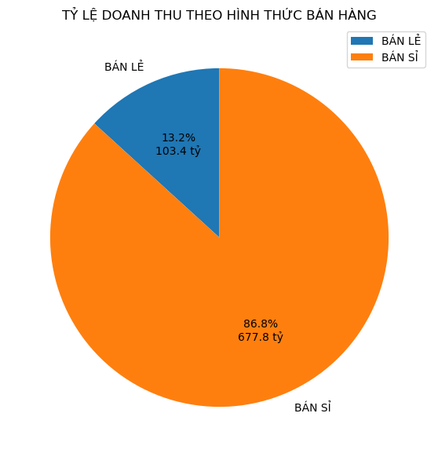
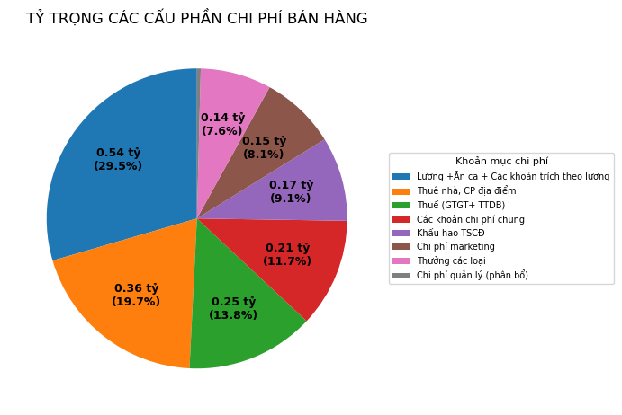
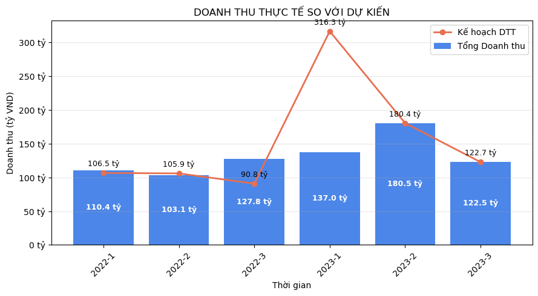
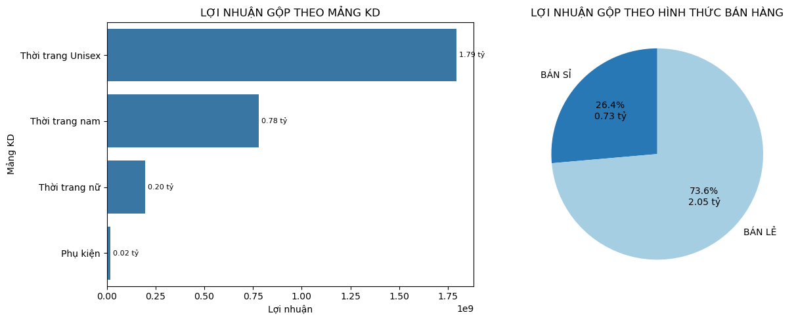
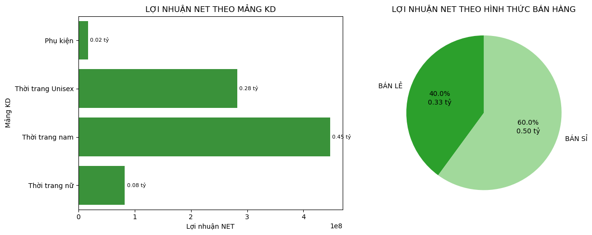
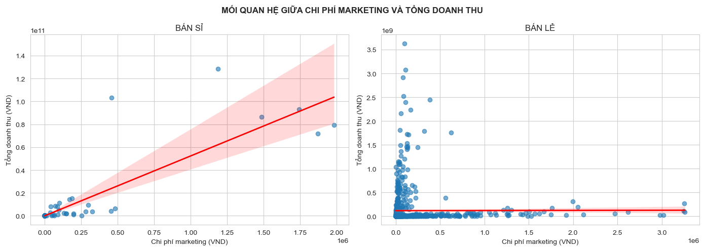
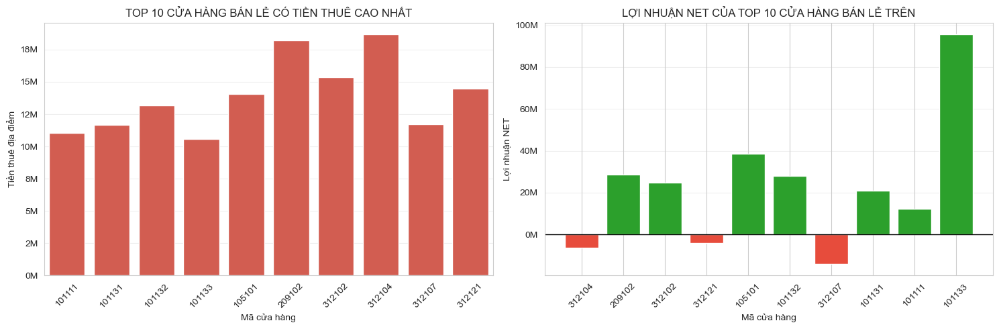
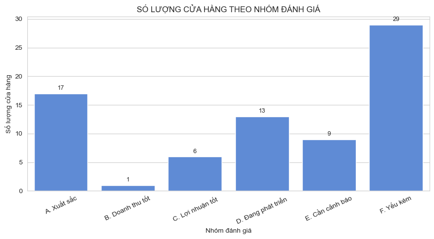

# 📊 BUSINESS PERFORMANCE ANALYSIS: GCONTEST REPORT

### Phân tích Kết quả Kinh doanh Quý 1 (2022 & 2023) và Phân loại Cửa hàng theo Mô hình IQR & KPI


> **Mục đích dự án:** Khai phá dữ liệu và phân tích toàn diện tình hình kinh doanh Quý 1 năm 2022 & 2023 của hệ thống 75 cửa hàng thuộc 13 chi nhánh trên 3 miền; đánh giá biến động doanh thu, hiệu quả lợi nhuận, tác động của giá vốn và các khoản chi phí vận hành (Marketing, Thuê địa điểm, Lương) trên hai kênh Bán sỉ và Bán lẻ; từ đó áp dụng phương pháp Tứ phân vị (IQR) kết hợp mức độ hoàn thành chỉ tiêu kế hoạch để xếp hạng, phân loại cửa hàng và đề xuất giải pháp kinh doanh thực tế.

---

## 📑 Mục lục
1. [Cấu trúc thư mục Repository](#1-cấu-trúc-thư-mục-repository)
2. [Khai phá dữ liệu & Phân nhóm chỉ tiêu](#2-khai-phá-dữ-liệu--phân-nhóm-chỉ-tiêu)
3. [Tổng quan tình hình kinh doanh](#3-tổng-quan-tình-hình-kinh-doanh)
4. [Phân tích Doanh thu](#4-phân-tích-doanh-thu)
5. [Phân tích Hiệu quả kinh doanh](#5-phân-tích-hiệu-quả-kinh-doanh)
6. [Phân tích Ảnh hưởng của Giá vốn & Chi phí vận hành](#6-phân-tích-ảnh-hưởng-của-giá-vốn--chi-phí-vận-hành)
7. [Phân loại & Đánh giá cửa hàng theo IQR](#7-phân-loại--đánh-giá-cửa-hàng-theo-iqr)
8. [Đề xuất kinh doanh](#8-đề-xuất-kinh-doanh)

---

## 1. Cấu trúc thư mục Repository

```text
Gcontest-NVTD-business_project-Analysis/
├── .gitignore                      # Bộ lọc chặn file rác, file tạm, checkpoint, OS files
├── README.md                       # Tài liệu báo cáo phân tích tổng hợp
├── data/
│   ├── raw/                        # Dữ liệu P&L gốc (GCONTEST2023-DATA-VÒNG-2.xlsx)
│   ├── sample/
│   │   └── sample_data_1000.csv    # 1.000 dòng dữ liệu mẫu trích xuất phục vụ preview nhanh
│   └── data_dictionary.md          # Từ điển dữ liệu chuẩn hóa 36 trường P&L
├── scripts/
│   └── Data_pocessing.ipynb        # Mã nguồn xử lý, phân tích EDA, Correlation & IQR
├── reports/
│   └── NVTD Gcontest business analysis.pdf  # Báo cáo trình bày chi tiết 25 trang
└── docs/
    └── images/                     # Biểu đồ gốc trích xuất trực tiếp từ Data_pocessing.ipynb
        ├── 01_ty_le_doanh_thu_kenh_ban.png
        ├── 02_co_cau_chi_phi_ban_hang.png
        ├── 03_doanh_thu_thuc_te_vs_ke_hoach.png
        ├── 05_loi_nhuan_gop_mang_va_kenh.png
        ├── 06_loi_nhuan_net_mang_va_kenh.png
        ├── 07_tuong_quan_marketing_doanh_thu.png
        ├── 09_top10_thue_mat_bang_ban_le.png
        └── 10_phan_loai_cua_hang_iqr.png
```

---

## 2. Khai phá dữ liệu & Phân nhóm chỉ tiêu

Tập dữ liệu gồm **1.218 bản ghi x 36 cột** của **75 cửa hàng (`Mã TT`)** thuộc **13 chi nhánh** tại **3 khu vực** (`MIỀN BẮC`, `MIỀN TRUNG`, `MIỀN NAM`) trong Quý 1/2022 và Quý 1/2023. Sử dụng các thư viện Python (`pandas`, `ydata-profiling`, `seaborn`, `matplotlib`, `openpyxl`), 36 trường dữ liệu được chia thành 5 nhóm nghiệp vụ:

| STT | Nhóm chỉ tiêu | Các trường dữ liệu trong tập dữ liệu |
| :-: | :--- | :--- |
| **1** | **Nhóm phân loại** | `KHU VỰC`, `CHI NHÁNH`, `Mã TT`, `Tháng`, `Quý`, `NĂM`, `Mảng KD`, `Hình thức bán hàng` |
| **2** | **Nhóm doanh thu** | `Tổng Doanh thu`, `Doanh thu thuần`, `Các khoản giảm trừ DT`, `Kế hoạch DTT` |
| **3** | **Nhóm chi phí** | `Giá vốn`, `Chi phí bán hàng`, `Chi phí marketing`, `Chi phí quản lý (phân bổ)`, `Lương +Ăn ca + Các khoản trích theo lương`, `Thưởng các loại`, `Thuê nhà, CP địa điểm`, `Khấu hao TSCĐ`, `Thuế (GTGT+ TTDB)`, `Các khoản chi phí chung` |
| **4** | **Nhóm lợi nhuận** | `Lợi nhuận gộp`, `Lợi nhuận thuần từ hoạt động kinh doanh`, `Lợi nhuận NET`, `Lợi nhuận sau thuế`, `Tổng lợi nhuận trước thuế`, `Kế hoạch LNN` |
| **5** | **Nhóm tài chính** | `Lợi nhuận thuần từ hoạt động tài chính`, `Doanh thu hoạt động tài chính`, `Chi phí hoạt động tài chính`, `Thu nhập khác`, `Chi phí khác`, `Lợi nhuận khác` |

---

## 3. Tổng quan tình hình kinh doanh

### 3.1. Quy mô tăng trưởng ấn tượng Quý 1/2023 nhưng Biên lợi nhuận gộp cực mỏng
- **Tổng doanh thu Quý 1/2023 đạt 439.98 tỷ VND** (+28.92% so với Quý 1/2022) và **Lợi nhuận gộp đạt 1.69 tỷ VND** (+54.62%). Tuy nhiên, biên lợi nhuận gộp của Quý 1 cả 2 năm đều rất mỏng, chỉ quanh ngưỡng **0.32% - 0.38%** (quy mô tăng mạnh nhưng giá trị gia tăng giữ lại rất thấp).
- **Doanh thu tập trung cục bộ**: Bản ghi cao nhất (Max) chiếm gần 1/3 tổng doanh thu quý (128.30 tỷ VND), trong khi mức thấp nhất (Min) bằng 0.00 tỷ VND, cho thấy doanh thu tập trung vào một số điểm bán cố định và có nhiều nơi chưa mang về doanh thu.

| Chỉ tiêu tổng quan | Quý 1 / 2022 | Quý 1 / 2023 | Biến động (YoY) | Nhận định cốt lõi |
| :--- | :---: | :---: | :---: | :--- |
| **Tổng Doanh thu** | 341.28 tỷ | 439.98 tỷ | **+28.92%** | Quy mô doanh số mở rộng mạnh mẽ |
| **Lợi nhuận gộp** | 1.09 tỷ | 1.69 tỷ | **+54.62%** | Tăng trưởng nhanh hơn tốc độ tăng doanh thu |
| **Biên lợi nhuận gộp** | 0.32% | 0.38% | **+0.06 điểm %** | Biên lãi gộp cực mỏng, giá trị giữ lại thấp |
| **Lợi nhuận NET** | 0.34 tỷ | 0.49 tỷ | **+44.12%** | Biên lợi nhuận ròng chỉ đạt ~0.10% - 0.11% |
| **Tổng Doanh thu cao nhất (Max)** | 103.35 tỷ | 128.30 tỷ | **+24.14%** | Tập trung lớn ở 1 chi nhánh/cửa hàng cố định |
| **Tổng Doanh thu thấp nhất (Min)** | 0.00 tỷ | 0.00 tỷ | - | Tồn tại các điểm bán không phát sinh doanh thu |

### 3.2. Miền Bắc là trung tâm kinh tế - Đứng đầu về Doanh thu, Giá vốn, Lợi nhuận và Chi phí
- **Miền Bắc giữ vị thế áp đảo tuyệt đối**: Đạt 352.4 tỷ VND doanh thu riêng Quý 1/2023 (lũy kế đạt **635.21 tỷ VND**) và Giá vốn **633.19 tỷ VND** (chiếm hơn **81%** toàn hệ thống). Dù phát sinh chi phí bán hàng cao nhất (0.912 tỷ VND), Miền Bắc vẫn là khu vực duy nhất tạo thặng dư lớn với **868 triệu VND Lợi nhuận NET** (phụ thuộc chính vào cửa hàng `101101` tại Hà Nội nắm giữ >70% giá vốn chuỗi).

| Khu vực | Tổng Doanh thu (Tỷ) | Giá vốn (Tỷ) | Lợi nhuận gộp (Tỷ) | Chi phí bán hàng (Tỷ) | Lợi nhuận NET (Tỷ) |
| :--- | :---: | :---: | :---: | :---: | :---: |
| **MIỀN BẮC** | **635.209** (81.3%) | **633.192** (81.4%) | **1.822** (65.4%) | **0.912** (50.3%) | **+0.868** |
| **MIỀN NAM** | 107.497 (13.8%) | 106.675 (13.7%) | 0.718 (25.8%) | 0.745 (41.1%) | **-0.115** |
| **MIỀN TRUNG** | 38.552 (4.9%) | 38.253 (4.9%) | 0.246 (8.8%) | 0.157 (8.6%) | **+0.077** |
| **Toàn hệ thống** | **781.258** (100%) | **778.120** (100%) | **2.786** (100%) | **1.814** (100%) | **+0.829** |

### 3.3. Kênh Bán sỉ áp đảo (86.8%) & Cơ cấu chi phí cố định chiếm tỷ trọng lớn
- **Theo kênh bán**: Kênh **Bán sỉ** áp đảo với **86.8%** tổng doanh thu (677.85 tỷ VND), trong khi **Bán lẻ** chỉ chiếm **13.2%** (103.41 tỷ VND). Nguồn vốn hàng hóa bị khóa chặt vào kênh sỉ và thời trang nam.



- **Theo cấu phần chi phí bán hàng**: Định phí chiếm tỷ trọng lớn nhất gồm **Lương nhân viên (29.5% - 0.54 tỷ)** và **Thuê địa điểm (19.7% - 0.36 tỷ)**, tổng cộng chiếm **49.2%**. Trong khi đó, chi phí thúc đẩy doanh số rất khiêm tốn: **Marketing chỉ chiếm 8.1% (0.15 tỷ)** và **Thưởng chiếm 7.6% (0.14 tỷ)**.



---

## 4. Phân tích Doanh thu

### 4.1. Phân hóa doanh thu cực đoan & Thực tế thực hiện kế hoạch
- **Cửa hàng 101101 (Hà Nội)** chiếm 85% - 90% doanh thu chi nhánh và **71.96% doanh thu toàn hệ thống**; độ lệch chuẩn toàn chuỗi lên tới **6.74 tỷ VND** (trung bình 641.4 triệu VND cao gấp nhiều lần trung vị 760 nghìn VND).
- **3/4 bản ghi dưới 20 triệu VND**: Toàn hệ thống có **35.0% bản ghi "Không có doanh thu"** (426 lượt = 0) và **40.0% bản ghi "Doanh thu kém"** (487 lượt < 19.76 triệu VND); toàn bộ động lực dồn vào **25.0% bản ghi "Doanh thu tốt"** (305 lượt). Có tới **45/75 cửa hàng (60%)** không có doanh thu trong ít nhất 1 tháng.
- **Thực tế vs Kế hoạch & Ảnh hưởng Lễ Tết**: Nhóm doanh thu kém không đạt chỉ tiêu ở cả 6 kỳ; nhóm doanh thu tốt hầu hết đạt chỉ tiêu trừ tháng 1/2023. Năm 2022 (Tết rơi vào 01/02) khiến doanh thu tháng 2 chạm đáy **103.1 tỷ VND**; năm 2023 (Tết rơi vào 22/01) giúp tháng 2 hoạt động trọn vẹn và đạt đỉnh **180.5 tỷ VND** (+31.8% so với tháng 1).



### 4.2. Điểm nghẽn theo Chi nhánh & Mảng kinh doanh
- **Chi nhánh TP.HCM** chiếm hơn 50% số bản ghi bằng 0 (232/426 bản ghi), trong khi **Hà Nội** dẫn đầu với 118 bản ghi doanh thu tốt.
- **Tất cả các mảng đều tăng trưởng nhưng Thời trang nam áp đảo 99% doanh thu**: Dù Phụ kiện (+324.2%) và Thời trang nữ (+64.4%) tăng trưởng nhanh trong Quý 1/2023, tổng doanh thu 3 mảng (Nữ, Unisex, Phụ kiện) cộng lại vẫn chưa tới 1%. Thời trang nữ kém hiệu quả nhất khi có tới 189 bản ghi rỗng, 236 bản ghi kém và chỉ có 4 lượt đạt doanh thu tốt.

| Mảng kinh doanh | Doanh thu Quý 1/2022 (Tỷ) | Doanh thu Quý 1/2023 (Tỷ) | Tăng trưởng YoY (%) | Tỷ trọng Quý 1/2023 (%) | Không có DT (= 0) | DT kém (< 19.76M) | DT tốt (>= 19.76M) |
| :--- | :---: | :---: | :---: | :---: | :---: | :---: | :---: |
| **Thời trang nam** | 337.655 | **435.725** | +29.04% | **99.03%** | 161 | 21 | **217** (71.1%) |
| **Thời trang Unisex** | 3.388 | 3.703 | +9.29% | 0.84% | 73 | 225 | **80** (26.2%) |
| **Thời trang nữ** | 0.169 | 0.279 | **+64.44%** | 0.06% | **189** | **236** | **4** (1.3%) |
| **Phụ kiện** | 0.065 | 0.275 | **+324.16%** | 0.06% | 3 | 5 | **4** (1.3%) |
| **Tổng cộng** | **341.277** | **439.982** | **+28.92%** | **100.00%** | **426 (35.0%)** | **487 (40.0%)** | **305 (25.0%)** |

---

## 5. Phân tích Hiệu quả kinh doanh

### 5.1. Miền Nam là điểm nghẽn lợi nhuận toàn hệ thống - Top 5 thuộc Miền Bắc & Bottom 5 thuộc Miền Nam
- **Lợi nhuận ròng lũy kế đạt 91.3% chỉ tiêu** (829 triệu / 909 triệu VND), có 4/6 kỳ không đạt kế hoạch (tháng 2/2023 gánh chỉ tiêu tổng thể, tháng 3/2023 chỉ đạt 37.6%). Nhóm *"Doanh thu tốt"* đạt 100% chỉ tiêu phải bù lỗ cho nhóm *"Doanh thu kém"* bị âm cả 6 kỳ.
- **Đối lập vùng miền**: Toàn bộ **Top 5 cửa hàng lợi nhuận cao nhất thuộc Miền Bắc** (4 tại Hà Nội, 1 tại Hải Phòng), trong khi **toàn bộ Bottom 5 lỗ nặng nhất thuộc Miền Nam** (4 tại TP.HCM, 1 tại Cần Thơ) dù nhiều điểm bán tại TP.HCM và Cần Thơ có doanh thu tương đương hoặc cao hơn các cửa hàng Hà Nội.

| Nhóm xếp hạng | Mã TT | Chi nhánh | Khu vực | Tổng Doanh thu (Triệu) | Lợi nhuận gộp (Triệu) | Lợi nhuận NET (Triệu) |
| :--- | :---: | :--- | :---: | :---: | :---: | :---: |
| **Top 1 Lợi nhuận** | `101101` | Hà Nội | MIỀN BẮC | 562,199.29 | 466.46 | **+334.44** |
| **Top 2 Lợi nhuận** | `101102` | Hà Nội | MIỀN BẮC | 526.83 | 133.68 | **+103.76** |
| **Top 3 Lợi nhuận** | `101133` | Hà Nội | MIỀN BẮC | 584.27 | 170.48 | **+95.81** |
| **Top 4 Lợi nhuận** | `101129` | Hà Nội | MIỀN BẮC | 633.73 | 150.42 | **+72.21** |
| **Top 5 Lợi nhuận** | `105101` | CN Hải Phòng | MIỀN BẮC | 13,366.18 | 142.78 | **+48.66** |
| **Bottom 5 (Lỗ)** | `312115` | CN Hồ Chí Minh | MIỀN NAM | 244.38 | 19.11 | **-12.76** |
| **Bottom 4 (Lỗ)** | `312107` | CN Hồ Chí Minh | MIỀN NAM | 1,345.37 | 24.85 | **-14.13** |
| **Bottom 3 (Lỗ)** | `312114` | CN Hồ Chí Minh | MIỀN NAM | 512.96 | 11.83 | **-16.28** |
| **Bottom 2 (Lỗ)** | `312105` | CN Hồ Chí Minh | MIỀN NAM | 353.75 | 11.64 | **-16.30** |
| **Bottom 1 (Lỗ nặng nhất)** | `311101` | CN Cần Thơ | MIỀN NAM | 25,075.75 | 44.72 | **-19.12** |

### 5.2. Bán lẻ và Unisex tạo lãi gộp khủng nhưng bị bào mòn bởi chi phí vận hành
- **Kênh Bán lẻ** tạo ra **73.6% tổng lãi gộp (2.05 tỷ VND)** nhưng do gánh chi phí vận hành quá lớn (1.52 tỷ VND) nên chỉ giữ lại được **0.33 tỷ VND lợi nhuận NET (39.9%)**, nhường vị trí dẫn đầu lãi ròng cho Bán sỉ (0.50 tỷ VND - 60.1%).
- **Mảng Unisex** là "ngôi sao" lãi gộp với **1.79 tỷ VND** (gấp hơn 2 lần đồ Nam), nhưng sau khi trừ chi phí bán hàng (1.33 tỷ VND) thì lợi nhuận NET bị co hẹp **84%**, chỉ còn **0.28 tỷ VND**, nhường vị trí dẫn đầu lãi ròng cho **Thời trang nam (0.45 tỷ VND)**.

| Phân nhóm | Tổng Doanh thu (Tỷ) | Giá vốn (Tỷ) | Lợi nhuận gộp (Tỷ) | Chi phí bán hàng (Tỷ) | Lợi nhuận NET (Tỷ) | Tỷ lệ giữ lại LN NET / Lãi gộp |
| :--- | :---: | :---: | :---: | :---: | :---: | :---: |
| **Kênh: BÁN SỈ** | **677.845** | 677.079 | 0.735 (26.4%) | 0.293 (16.2%) | **0.498** (60.1%) | **67.8%** |
| **Kênh: BÁN LẺ** | 103.413 | 101.041 | **2.051** (73.6%) | **1.521** (83.8%) | 0.331 (39.9%) | **16.1%** (Bị bào mòn 83.9%) |
| **Mảng: Thời trang nam** | **773.379** | 772.600 | 0.779 (28.0%) | 0.315 (17.4%) | **0.447** (53.9%) | **57.4%** |
| **Mảng: Thời trang Unisex** | 7.090 | 4.976 | **1.793** (64.4%) | **1.327** (73.2%) | 0.282 (34.0%) | **15.7%** (Bị bào mòn 84.3%) |
| **Mảng: Thời trang nữ** | 0.448 | 0.221 | 0.196 (7.0%) | 0.172 (9.5%) | 0.083 (10.0%) | **42.3%** |
| **Mảng: Phụ kiện** | 0.340 | 0.323 | 0.017 (0.6%) | 0.000 (0.0%) | 0.017 (2.1%) | **100.0%** |





---

## 6. Phân tích Ảnh hưởng của Giá vốn & Chi phí vận hành

### 6.1. Tác động của Giá vốn & Ma trận tương quan Chi phí giữa hai kênh bán
- **Doanh thu thuần và Giá vốn biến động cùng chiều tuyệt đối (r = 1.000)**, biên lợi nhuận gộp đi ngang ngay cả trong cao điểm Tết (tháng 1 - 2/2023), cho thấy việc mở rộng quy mô chưa đi kèm tối ưu hóa tỷ suất sinh lời.
- **Phản hồi chi phí trái ngược trên hai kênh**: Ở kênh **Bán sỉ**, mọi khoản chi phí đều tương quan chặt với doanh thu và lợi nhuận ròng; ngược lại ở kênh **Bán lẻ**, chi phí gần như không tạo ra phản hồi doanh số:

| Khoản mục Chi phí đầu tư | Tương quan (r) với Doanh thu (BÁN SỈ) | Tương quan (r) với LN NET (BÁN SỈ) | Tương quan (r) với Doanh thu (BÁN LẺ) | Tương quan (r) với LN NET (BÁN LẺ) |
| :--- | :---: | :---: | :---: | :---: |
| **Chi phí Marketing** | **+0.864** (Rất mạnh) | **+0.655** | **+0.003** (Không phản hồi) | +0.429 |
| **Lương + Ăn ca + Trích theo lương** | **+0.840** (Rất mạnh) | **+0.767** | **+0.071** (Rất yếu) | +0.420 |
| **Thuê nhà, CP địa điểm** | **+0.729** (Mạnh) | **+0.800** | **-0.078** (Tương quan âm) | +0.304 |
| **Thưởng các loại** | **+0.591** (Khá mạnh) | **+0.683** | **+0.017** (Rất yếu) | +0.629 |

### 6.2. Ảnh hưởng của Chi phí Marketing: Đầu tư lệch điểm nghẽn
- **Phân bổ ngược chiều hiệu quả**: Hơn **91.4% ngân sách Marketing** đổ vào Bán lẻ (r = 0.003) và **82.8%** dồn vào dòng Unisex. Trong khi đó, Bán sỉ (chỉ nhận **8.6%**) và Thời trang nam (nhận **16.1%**) có độ nhạy doanh thu rất cao (r = 0.864) lại chỉ nhận ngân sách thiểu số.
- **Đầu tư sai điểm nghẽn bán lẻ**: Dồn ngân sách cao nhất cho `105191` và `209102` không giúp bứt phá doanh số (trong khi `209101` chi rất thấp lại đạt doanh thu cao). Toàn chuỗi có **52/75 cửa hàng** có tháng không chi Marketing vẫn tự tạo doanh thu ổn định (đặc biệt tại Hà Nội và TP.HCM).



### 6.3. Ảnh hưởng của Chi phí Thuê địa điểm & Chi phí Lương
- **Tiền thuê mặt bằng bán lẻ đắt đỏ không mang lại hiệu quả (r = -0.078)**: Trong Top 10 cửa hàng bán lẻ có tiền thuê cao nhất, có **3/10 cửa hàng bị lỗ ròng** (`312104`, `312121`, `312107`), trong đó cửa hàng có tiền thuê đắt nhất toàn chuỗi (**`312104`** tại TP.HCM - 18.67 triệu VND) vẫn không đạt điểm hòa vốn (lỗ **-6.36 triệu VND**).

| Hạng thuê | Mã TT | Chi nhánh | Thuê nhà, CP địa điểm (Triệu) | Tổng Doanh thu (Triệu) | Lợi nhuận NET (Triệu) | Trạng thái hòa vốn |
| :-: | :---: | :--- | :---: | :---: | :---: | :--- |
| **1** | `312104` | CN Hồ Chí Minh | **18.67** | 3,846.60 | **-6.36** | Lỗ ròng (Không hòa vốn) |
| **2** | `209102` | CN Đà Nẵng | **18.21** | 3,547.91 | +28.78 | Có lãi |
| **3** | `312102` | CN Hồ Chí Minh | **15.34** | 3,533.22 | +24.94 | Có lãi |
| **4** | `312121` | CN Hồ Chí Minh | **14.46** | 611.62 | **-4.00** | Lỗ ròng (Không hòa vốn) |
| **5** | `105101` | CN Hải Phòng | **14.05** | 3,692.75 | +38.46 | Có lãi |
| **6** | `101132` | Hà Nội | **13.15** | 185.13 | +27.87 | Có lãi |
| **7** | `312107` | CN Hồ Chí Minh | **11.70** | 1,345.37 | **-14.13** | Lỗ ròng (Không hòa vốn) |
| **8** | `101131` | Hà Nội | **11.65** | 164.37 | +20.83 | Có lãi |
| **9** | `101111` | Hà Nội | **11.04** | 3,212.43 | +12.42 | Có lãi |
| **10** | `101133` | Hà Nội | **10.58** | 584.27 | +95.81 | Có lãi |

- **Quỹ lương bán lẻ đè nặng biên lãi (r = 0.071)**: Khác với Bán sỉ (lương gắn liền với các điểm doanh thu vượt 90 tỷ, r = 0.840), quỹ lương cao tại các điểm bán lẻ vắng khách đang đóng vai trò là định phí cố định ăn mòn toàn bộ lợi nhuận gộp.



---

## 7. Phân loại & Đánh giá cửa hàng theo IQR

Chia `Tổng Doanh thu` và `Lợi nhuận gộp` của 75 cửa hàng bằng phương pháp **Tứ phân vị (IQR)** tại các mốc phân vị **25%, 50%, 75%** để chấm điểm từ **1 đến 4**, kết hợp với 2 chỉ tiêu hoàn thành kế hoạch `achived_net_revenue` (0 hoặc 1) và `achived_net_profit` (0 hoặc 1) để ghép thành mã đánh giá 4 chữ số (`final_evaluation`):

| Thang điểm | Điểm Doanh thu (`score_revenue`) | Điểm Lợi nhuận gộp (`score_gross_profit`) | Đạt KH Doanh thu (`achived_net_revenue`) | Đạt KH Lợi nhuận NET (`achived_net_profit`) |
| :---: | :--- | :--- | :--- | :--- |
| **Điểm 1** | <= 43.73 triệu VND (Dưới mốc 25%) | <= 6.81 triệu VND (Dưới mốc 25%) | `0`: Không đạt (DTT < KH DTT) | `0`: Không đạt (LN NET < KH LNN) |
| **Điểm 2** | 43.73M - 352.99M (Mốc 25% đến 50%) | 6.81M - 12.80M (Mốc 25% đến 50%) | `1`: Đạt (DTT >= KH DTT) | `1`: Đạt (LN NET >= KH LNN) |
| **Điểm 3** | 352.99M - 2.091 tỷ (Mốc 50% đến 75%) | 12.80M - 42.55M (Mốc 50% đến 75%) | - | - |
| **Điểm 4** | > 2.091 tỷ VND (Trên mốc 75%) | > 42.55 triệu VND (Trên mốc 75%) | - | - |

Từ mã điểm `final_evaluation`, 75 cửa hàng được phân loại vào **6 nhóm đánh giá (từ A đến F)**:

| Nhóm đánh giá | Mã điểm (`final_evaluation`) | Số lượng | Tỷ trọng | Danh sách Mã cửa hàng (`Mã TT`) thuộc nhóm |
| :--- | :---: | :---: | :---: | :--- |
| **A. Xuất sắc** | `4411`, `4311`, `3411`... | **17** | **22.7%** | `101101`, `101102`, `101107`, `101109`, `101110`, `101111`, `101113`, `101115`, `101117`, `101129`, `101133`, `105101`, `209101`, `209104`, `312102`, `312103`, `312106` |
| **B. Doanh thu tốt** | `3111`, `3110`, `4210`, `4211` | **1** | **1.3%** | `101103` |
| **C. Lợi nhuận tốt** | `2311`, `1301`, `2411`, `2301` | **6** | **8.0%** | `101125`, `101127`, `101131`, `101132`, `105102`, `312108` |
| **D. Đang phát triển** | `1111`, `2211`, `1310`, `4101`... | **13** | **17.3%** | `101106`, `101108`, `101119`, `101126`, `209102`, `311101`, `312104`, `312107`, `312112`, `312113`, `312117`, `312118`, `312121` |
| **E. Cần cảnh báo** | `1110`, `2210`, `1101`, `2201` | **9** | **12.0%** | `101120`, `101130`, `101135`, `105103`, `209106`, `311102`, `311301`, `312111`, `312120` |
| **F. Yếu kém** | `1200`, `1100`, `2100`, `3100` | **29** | **38.7%** | `101105`, `101112`, `101114`, `101116`, `101118`, `101121`, `101124`, `101128`, `105201`, `209103`, `209105`, `209201`, `311201`, `311202`, `311203`, `311401`, `311501`, `312105`, `312109`, `312110`, `312114`, `312115`, `312116`, `312119`, `312122`, `312123`, `312124`, `312201`, `312301` |



---

## 8. Đề xuất kinh doanh

| STT | Chiến lược trọng tâm | Đối tượng áp dụng | Nội dung hành động chi tiết |
| :-: | :--- | :--- | :--- |
| **1** | **Tái cơ cấu và xử lý dứt điểm các điểm bán yếu kém** | **29 điểm bán Nhóm F (Yếu kém)** & các điểm lỗ nặng tại Miền Nam (`311101`, `312104`, `312105`) | Rà soát khẩn cấp các chi nhánh lỗ nặng tại TP.HCM và Cần Thơ (đặc biệt là các mã `311101`, `312104`, `312105`); kiên quyết thu hẹp diện tích, đàm phán lại tiền thuê mặt bằng hoặc đóng cửa các điểm không phát sinh doanh số để ngắt dòng chảy máu lợi nhuận ròng. |
| **2** | **Tái phân bổ ngân sách Marketing theo hiệu quả biên** | **Kênh Bán sỉ, Thời trang Nam** & **52 điểm bán tự tạo doanh thu** | Cắt giảm ngân sách tiếp thị đại trà ở mảng Bán lẻ và dòng Unisex (nơi đang ngốn hơn 80% kinh phí nhưng không tạo thanh khoản) để phân bổ chi phí Marketing vào mảng Bán sỉ và Thời trang Nam nhiều hơn (nơi tạo ra nguồn doanh thu của toàn bộ hệ thống). Đồng thời ngừng chi quá nhiều chi phí Marketing cho 52 điểm bán đã có lưu lượng khách tự nhiên ổn định tại Hà Nội và TP.HCM. |
| **3** | **Bảo vệ biên lãi mảng Bán lẻ bằng cơ chế kiểm soát định phí** | **Hệ thống cửa hàng kênh Bán lẻ** | Tách bạch quỹ lương cứng và tiền thuê mặt bằng khỏi rủi ro bán hàng thông qua việc áp dụng tỷ trọng lương thưởng linh hoạt theo KPI doanh số tại các điểm bán lẻ, ngăn chặn việc chi phí nhân sự và mặt bằng đắt đỏ ăn mòn sạch lãi gộp. |
| **4** | **Bảo vệ hạt nhân tăng trưởng và bồi dưỡng nhóm tiềm năng** | **17 cửa hàng Nhóm A (Xuất sắc)** & **13 cửa hàng Nhóm D (Đang phát triển)** | Giữ vững cơ chế đãi ngộ và ưu tiên luân chuyển nguồn hàng cho 17 cửa hàng Xuất sắc (Nhóm A, đứng đầu là `101101`, `101102`) để duy trì và tiếp tục mở rộng, nhân rộng mô hình kinh doanh; đồng thời tập trung bổ sung danh mục sản phẩm có chọn lọc cho 13 cửa hàng Đang phát triển (Nhóm D) để sớm nhân rộng quy mô doanh thu. |
